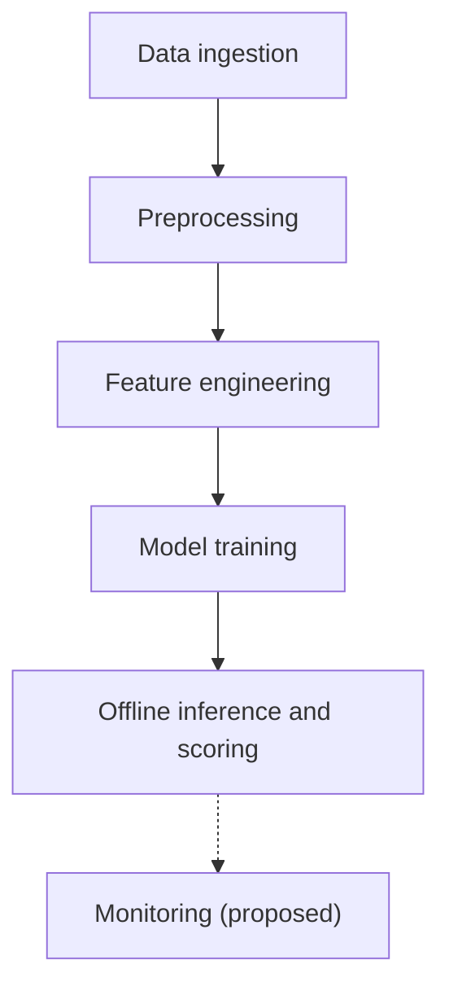

Fraud Detection in Digital Payment Systems
Rank suspicious transactions using cost-sensitive machine learning.


Summary
This MSc Data Science (FinTech) project evaluates how well a classifier can rank potentially fraudulent digital payment transactions. It compares tree-based models on a dataset where only 3.5% of transactions are labelled fraud. The Random Forest improved held-out average precision from 0.3523 to 0.6377, but flagged about 45% of actual fraud cases under its default prediction rule. The notebook supports offline experimentation and illustrates the trade-off between alert quality and fraud coverage.
Contents
Features · Use cases · Pipeline · Dataset · Models · Quickstart · Training · Results · Deployment · Privacy · Limitations · Contribute · License · Maintainer · Appendix
Key features
Joins transaction and identity records by transaction ID.
Engineers transaction amount, device and email-domain features.
Compares four class-weighted ensemble models against a Decision Tree baseline.
Uses stratified cross-validation and average precision to compare fraud rankings.
Reports fraud precision, recall, F1 and a held-out confusion matrix.
Use cases
Fraud analysts can explore how model choices affect review queues. Data scientists can reproduce the benchmark and test time-based validation. Payment stakeholders can assess the balance between false alerts and missed fraud before designing an operational pilot.
Architecture and pipeline

Feature engineering and preprocessing are interleaved in the notebook. Fitted transformations currently run before the split.
Dataset
The IEEE-CIS Fraud Detection Kaggle competition provides de-identified transaction and identity data under its competition terms. The left join yields 590,540 transactions with 3.499% fraud. The notebook cleans device strings, handles missing values, encodes categories and scales numerical features. It removes the transaction identifier before using the 456-column feature matrix for modelling. Keep raw CSVs and row-level exports out of Git.
Models
The Decision Tree provides the baseline. The notebook compares cost-sensitive Random Forest, XGBoost, LightGBM and CatBoost. The final notebook run uses Random Forest with class weights recomputed for each bootstrap sample. Inputs include transaction amount and timing, card and address codes, device and email-domain attributes, and anonymised variables. SHAP explanations are proposed for follow-up work.
Installation and quickstart
From the repository root, install the dependencies and launch Jupyter. See the setup checklist for the notebook filename and data layout.
```bash
python -m pip install -r requirements.txt
jupyter notebook notebooks/fraud_detection.ipynb
```
Run the notebook through final evaluation. The examples below support fully preprocessed feature rows. For a local smoke test, append this cell after evaluation to export the fitted classifier and write an existing held-out row in the expected schema. Keep both outputs local.
```python
from pathlib import Path
import joblib

root = Path.cwd().parent if Path.cwd().name == "notebooks" else Path.cwd()
(root / "models").mkdir(exist_ok=True)
joblib.dump(best_rfc, root / "models" / "fraud.joblib")
(root / "sample.json").write_text(X_test.iloc[0].to_json(), encoding="utf-8")
```
```bash
python -m examples.score sample.json
python -m pip install fastapi uvicorn
python -m uvicorn examples.api:app --host 127.0.0.1 --port 8000
```
In another terminal at the repository root:
```bash
curl --fail-with-body -X POST http://127.0.0.1:8000/score \
  -H 'Content-Type: application/json' --data-binary @sample.json
```
Illustrative response: `{"fraud_score": 0.72, "label": "fraud"}`. The score comes from `predict_proba` and has no calibration guarantee. The label follows the model's `predict` rule. The API is optional local scaffolding.
```bash
docker build --build-arg SKLEARN_VERSION="$(python -c 'import sklearn; print(sklearn.__version__)')" -t fraud-scoring .
docker run --rm -p 127.0.0.1:8000:8000 \
  -v "$PWD/models:/app/models:ro" fraud-scoring
```
Use the same Python and dependency versions for training and scoring. The example Dockerfile starts from Python 3.11; change the base image to match the training environment if needed. Load only trusted model exports.
Training and reproduction
Place `train_transaction.csv` and `train_identity.csv` beside the notebook. Start a fresh kernel with the notebook directory as its working directory and run all cells in order. The notebook uses CPU estimators, a stratified 80/20 split, five stratified cross-validation folds and seed 42. Training requires no environment variables. Optional serving reads `MODEL_PATH`, which defaults to `models/fraud.joblib`. Capture the Python version and `pip freeze` for reproducibility across machines.
Random Forest setting	Final notebook run
Trees	500
Maximum depth	30
Minimum samples per leaf	1
Features considered per split	`log2`
Class weighting	`balanced_subsample`
Workers	`-1`
The six-candidate randomised search used average precision and reported a best cross-validation score of 0.7347 with unrestricted depth. The final run caps depth at 30 and has a different configuration.
Evaluation and results
Saved notebook outputs for the 118,108-row held-out split, including 4,133 fraud cases. The ranking metric is scikit-learn's `average_precision_score`, labelled PR-AUC in the notebook. Precision, recall and F1 use each model's default `predict` decision rule.
Metric	Decision Tree	Random Forest
Average precision	0.3523	0.6377
Fraud precision	0.5534	0.85
Fraud recall	0.6121	0.45
Fraud F1	0.5813	0.59
ROC-AUC	Unreported	Unreported
False positive rate	≈1.79%	See confusion matrix
Accuracy	96.91%	97.80%
Baseline false positive rate is derived from the displayed non-fraud recall. Random Forest class metrics are rounded as displayed in the notebook.

> **Dissertation run.** The report documents a separate configuration with 750 trees, `sqrt` feature sampling and depth 30. It reports held-out average precision of **0.7056**, fraud precision of **0.88**, recall of **0.48** and F1 of **0.63**. The two runs have different baseline average precision values and should be cited with their own results.
Monitoring, deployment and scalability
Start with batch scoring and monitor input missingness, score distributions, alert volumes and fraud recall once labels arrive. Streaming would require a versioned raw-to-feature pipeline, schema checks and a fallback path. Latency and throughput remain unbenchmarked. An illustrative engineering target for a streaming pilot is p95 scoring latency under 50 ms, subject to load testing and measured separately from end-to-end transaction latency.
Security, privacy and bias
Restrict access to source data and model artifacts, minimise retained identifiers and redact transaction details from logs. Compare false-positive and missed-fraud rates across available cohorts before relying on scores for decisions. Monitor changes in fraud patterns and feature distributions as data arrives.
Limitations and known failure modes
Imputation, category encoding and scaling were fitted before the train/test split. Refit within training folds and re-evaluate for a leakage-controlled estimate.
A random split does not measure performance on later transactions. Use a chronological hold-out and check for overlap among related entities.
The default prediction rule missed about 55% of held-out fraud cases. Select a decision threshold on separate validation data using fraud-loss costs and review capacity.
The model export expects the engineered feature matrix. Raw-event scoring requires a saved preprocessing pipeline, consistent category mappings and schema validation.
The dataset provides a research benchmark. Performance on live UK digital payments and explanation quality require separate validation.
How to contribute
Use the reproduction issue template. Before submitting a pull request:
[ ] Record the data version, split and seed.
[ ] Report ranking and threshold-dependent metrics.
[ ] Keep raw data and credentials out of commits.
[ ] Update the README and figures if results change.
License
`{{LICENSE}}`. The competition dataset has separate usage terms.
Contact and maintainers
Rahul Kante · MSc Data Science (FinTech), University of Greenwich · `{{PUBLIC_CONTACT}}`
Appendix
Path	Purpose
`README.md`	Full project documentation
`README.compact.md`	Portfolio-length alternative
`SETUP.md`	Setup, assets and publishing checklist
`notebooks/`	Original analysis notebook and local CSV inputs
`models/`	Local trusted model exports
`assets/`	Results banner, confusion matrix and Mermaid source
`examples/`	CLI scoring, API and plot-generation examples
`requirements.txt`	Example notebook dependencies
`Dockerfile`	Optional local scoring service
`.github/ISSUE_TEMPLATE/`	Reproduction issue template
Troubleshooting. For a missing CSV, check the kernel's working directory and filenames. For a missing model, run the export cell and check `MODEL_PATH`. For a schema error, use the exact numeric feature names from the exported estimator and apply the same transformations as in training.
